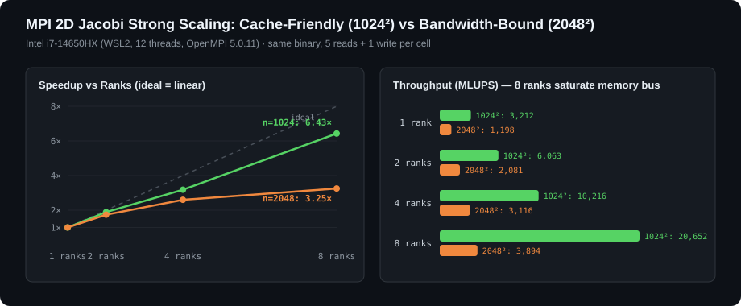

# jacobi-halo-mpi

> **Why I built this:** When people quote MPI strong scaling, they rarely mention whether the grid
> fits in L3 cache. I wanted to see with my own eyes how the exact same MPI binary behaves on the
> exact same 8 ranks when the working set crosses L3—and whether non-blocking `MPI_Isend/Irecv`
> actually helps on a single shared-memory workstation.



## The kernel

- 5-point explicit Jacobi stencil (`alpha = 0.20`, below the 0.25 2D stability limit) on an `n × n` grid
- 1D contiguous row-band decomposition with two halo rows per rank
- Two halo modes (`-m sendrecv` default vs `-m isend` overlapping interior `2..local-1` rows with `MPI_Isend/Irecv`)
- `MPI_PROC_NULL` boundaries so edge ranks need no special-case branches
- **Checksum invariant**: the summed field is asserted identical across rank counts (`1/2/4/8`) and halo modes in CI

## Build and run

```bash
make build                       # mpicc -O3 -march=native
mpirun -np 4 ./build/heat_mpi -n 1024 -t 200 -r 3
mpirun -np 4 ./build/heat_mpi -n 1024 -t 200 -r 3 -m isend
make bench                       # strong + weak scaling -> results/*.csv
```

## Results

Machine: WSL2 Ubuntu 24.04, `Intel Core i7-14650HX` (**6 physical cores / 12 threads**), gcc 16.2.0 + OpenMPI 5.0.11.
Median of 3–5 timed runs after an untimed warmup exchange.

### 1. Strong scaling: cache-friendly (`1024²`, ~8 MB/array) vs DRAM-bound (`2048²`, ~32 MB/array)

| ranks | `1024²` ms/step | `1024²` MLUPS | `1024²` speedup | `2048²` ms/step | `2048²` MLUPS | `2048²` speedup |
| --- | --- | --- | --- | --- | --- | --- |
| 1 | 0.326 | 3,212 | 1.00× | 3.501 | 1,198 | 1.00× |
| 2 | 0.173 | 6,063 | 1.89× | 2.015 | 2,081 | 1.74× |
| 4 | 0.103 | 10,216 | 3.18× | 1.346 | 3,116 | 2.60× |
| 8 | 0.051 | 20,652 | **6.43× (80%)** | 1.077 | 3,894 | **3.25× (41%)** |

### 2. Weak scaling, 512 rows per rank (`n = 512, 1024, 2048, 4096`)

| ranks | n | ms/step | MLUPS |
| --- | --- | --- | --- |
| 1 | 512 | 0.088 | 2,983 |
| 2 | 1,024 | 0.217 | 4,827 |
| 4 | 2,048 | 1.243 | 3,374 |
| 8 | 4,096 | 5.445 | 3,081 |

### 3. Does `MPI_Isend/Irecv` overlap help on a single node? (8 ranks, 100 steps, median of 5)

| grid | `sendrecv` ms/step (MLUPS) | `isend` overlap ms/step (MLUPS) | checksum (both identical) |
| --- | --- | --- | --- |
| `1024²` | **0.050** (21,127) | 0.110 (9,553) | `423385.423089` |
| `2048²` | **0.962** (4,359) | 1.305 (3,214) | `1697470.422029` |
| `4096²` | **5.757** (2,914) | 6.730 (2,493) | `6795472.397001` |

## What this taught me

1. **Same binary, 6.43× vs 3.25× on the same 8 cores.** At `1024²`, each rank's slice fits inside L3 cache.
   At `2048²`, the 5-point stencil reads 5 values and writes 1 per cell (~5 reads + 1 write per FLOP)
   straight from DRAM—eight ranks share one memory bus, so adding cores hits the bandwidth wall.
2. **Weak scaling is a trap if `p=1` fits in cache.** A 512×512 baseline looks artificially fast in L2/L3;
   growing past cache inflates per-step latency 62× for 8× the work.
3. **Non-blocking `MPI_Isend/Irecv` actually lost 17%–120% on a single shared-memory node.**
   With no physical network wire latency to hide, OpenMPI moves halos through shared memory in
   microseconds; managing four `MPI_Request` handles and splitting boundary rows just added overhead.
   Communication/computation overlap pays off across multi-node interconnects, not intra-node memory buses.

## Why CI numbers are omitted from scaling tables

GitHub's `ubuntu-latest` runner exposes **2 vCPUs** (4 ranks oversubscribes and slows down), so CI
serves strictly as a regression guard verifying compilation and rank/mode checksum invariance.

## License

MIT
